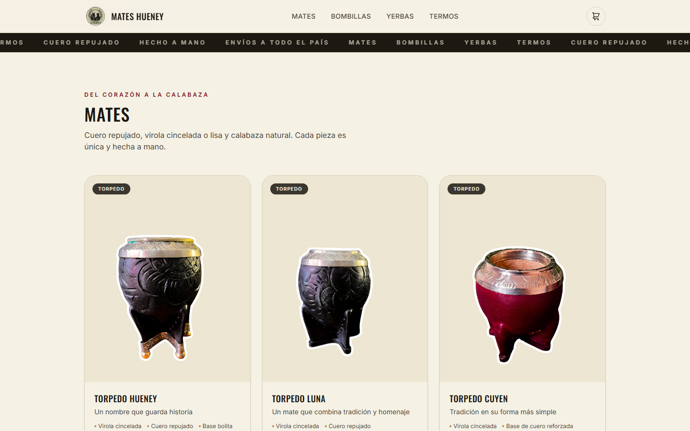

# Mates Hueney

**Live demo:** https://mates-hueney.vercel.app

| Home · Inicio | Catalog · Catálogo |
|---|---|
|  |  |

[English](#english) · [Español](#español)

---

## English

Online storefront for a mate brand: product catalog by category, product cards with color options, and a shopping cart.

### Features

- Product catalog grouped by line (mates, bombillas), with "coming soon" items
- Product cards with color variants, materials and features
- Cart drawer with global state through React Context
- Scroll reveal animations with Framer Motion
- Responsive layout

### Tech

Next.js 16 (App Router) · React 19 · TypeScript · Tailwind CSS 4 · Framer Motion · Vercel

### Structure

```
src/
  app/              layout and home page (App Router)
  components/       Header, Hero, ProductGrid, ProductCard, CategorySection, Footer
  components/cart/  CartProvider (React Context) and CartDrawer
  lib/products.ts   typed product catalog
```

### Run locally

```bash
npm install
npm run dev
```

---

## Español

Tienda online para una marca de mates: catálogo de productos por categoría, tarjetas de producto con opciones de color y carrito de compras.

### Funcionalidades

- Catálogo agrupado por línea (mates, bombillas), con productos "próximamente"
- Tarjetas de producto con variantes de color, materiales y características
- Carrito lateral con estado global mediante React Context
- Animaciones al hacer scroll con Framer Motion
- Diseño responsive

### Tecnologías

Next.js 16 (App Router) · React 19 · TypeScript · Tailwind CSS 4 · Framer Motion · Vercel

### Estructura

```
src/
  app/              layout y página principal (App Router)
  components/       Header, Hero, ProductGrid, ProductCard, CategorySection, Footer
  components/cart/  CartProvider (React Context) y CartDrawer
  lib/products.ts   catálogo de productos tipado
```

### Cómo correrla

```bash
npm install
npm run dev
```
